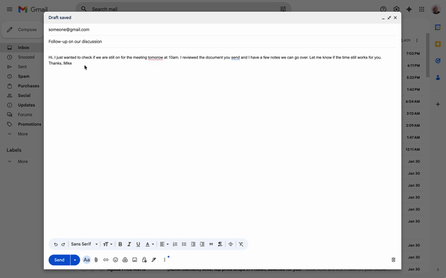
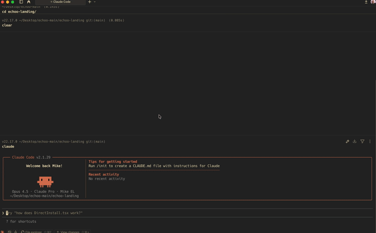
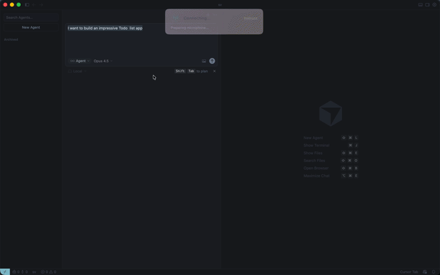
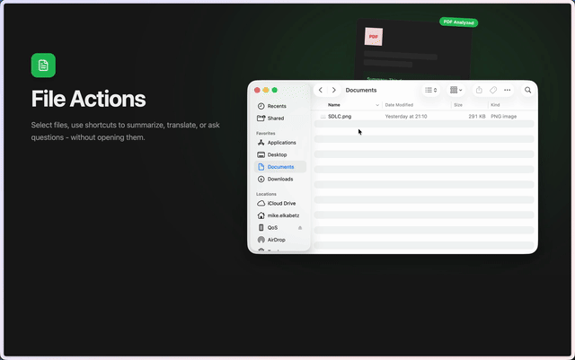
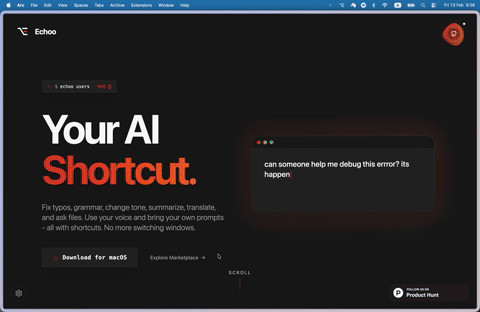

  <h1>Echoo - Your Personal AI Writing Assistant</h1>
  
  
Writing that fits you and the situation. Echoo draws on your background, screen context you share, and past conversations when Memory is on to refine your words where you already write. The fox briefly explains what changed and why.

  

    
    
    
  

  

    <a href="https://www.echoo.ai/"><strong>Download for Mac</strong></a> &middot;
    <a href="https://www.echoo.ai/marketplace">Find a skill</a> &middot;
    <a href="../../issues/new?labels=bug">Report a bug</a> &middot;
    <a href="../../issues/new?labels=enhancement">Request a feature</a>
  

  

    <a href="#your-personal-ai-writing-assistant">Your assistant</a> &middot;
    <a href="#tools-bring-context-skills-put-it-to-work">Tools &amp; Skills</a> &middot;
    <a href="#meet-the-fox">Meet the fox</a> &middot;
    <a href="#empower-your-fox">Custom skills</a> &middot;
    <a href="#quick-start">Quick start</a> &middot;
    <a href="#core-workflows">See it in use</a>
  

---

## Your Personal AI Writing Assistant

Your words carry your voice. Echoo helps you sharpen them in supported Mac text fields, using relevant context to choose the right tone, wording, spelling, and level of detail while preserving your meaning.

### Tools bring context. Skills put it to work.

**Tools** help your assistant understand the person behind the text and the situation:

| Tool | Context it brings |
|------|-------------------|
| **Your Background** | The role, audience, and writing preferences you supply in Personalization. |
| **Screen Context** | A screenshot of the conversation, document, or app on screen, attached when you enable it for a skill. |
| **Memory** | Earlier conversations within the same skill, helping preserve relevant terminology and preferences. Optional on Pro, Max, and Business; off by default. |

**Skills** are what you ask Echoo to do: Rewrite, To English, Summarize, Translate, or your own saved instructions. Your assistant uses the relevant background and enabled tools to shape the finished text. In 2.0, the actions previously called commands are called **Skills**.

Choose a Skill for the task and Tools for the context. For example, **Rewrite** can use your background to match your audience, **Screen Context** to get a project name right, and **Memory** to keep terminology consistent with earlier conversations. The same Tools can support different Skills; each Skill uses the context relevant to its task.

Write in your native language, polish a draft, or turn a long message into a clear summary. Echoo works in supported text fields in apps such as Mail, Slack, Notion, browsers, and editors. Compatibility depends on the app's macOS Accessibility support; some apps and fields are not supported.

### How it works

1. **Choose your text and skill** - Select a draft and pick what you want to do.
2. **Share useful context** - Supply your background, enable Screen Context, or turn on Memory on an eligible plan when it helps.
3. **Run the skill** - Use its shortcut or the floating Rewrite button.
4. **Review the result** - Your finished text appears inline or in a popup. The fox gives a short explanation of useful changes separately.

Built with Swift and SwiftUI for Mac.

## Meet the fox

Your writing assistant has a face and a little personality. After a writing skill finishes, the animated fox appears with a short, clear explanation of what changed and why. The explanation stays separate from the text you insert or copy.

For example, with **Screen Context** showing a project page titled **NovaFlow**:

| Original | Rewrite |
|----------|---------|
| I'll share the nova flow update today. | I'll share the NovaFlow update today. |

The fox explains:

> “nova flow” → “NovaFlow”, matching the project name on your screen.

The same idea applies to a tone shaped by your background or wording informed by previous conversations when Memory is on. Explanations focus on the actual change and the context that helped. Fox explanations are on by default and can be turned off in Settings; when off, Echoo generates only the finished text.

## Empower your fox

  

Each skill you add gives your assistant a new way to help. Write your own prompt or explore community skills in the [Marketplace](https://www.echoo.ai/marketplace), review the instructions, and add the ones that fit your work. The golden fox represents the assistant you shape with your skills.

For example, create a **Friendly reply** skill:

> Rewrite this message so it sounds friendly and clear. Keep my meaning.

Assign a shortcut, choose whether to include Screen Context, and optionally enable Memory on an eligible plan. Your rough draft now has a familiar path to a reply that sounds like you.

---

## Two Ways to Use Echoo

Start with 10 free credits, with no card or API key needed. An Echoo account is required.

| Mode | How it works | Memory |
|------|--------------|--------|
| **Managed AI** | Echoo handles provider setup. Pro includes 300 monthly credits for $6.99; Max includes 600 for $9.99. Business is quoted per seat. | Optional on Pro, Max, and Business |
| **Free Mode / BYOK** | Use your own cloud API key or a locally running model. No Echoo subscription fee; cloud providers bill API usage separately. | Not included |

One credit is one successful managed skill. Failed skills and BYOK usage do not consume credits. Monthly credits reset each billing cycle and do not roll over. See [current plans and limits](https://www.echoo.ai/pricing).

(<a href="#table-of-contents">back to top</a>)

---

<strong>Table of Contents</strong>

- [Your Personal AI Writing Assistant](#your-personal-ai-writing-assistant)
- [Tools and Skills](#tools-bring-context-skills-put-it-to-work)
- [Meet the Fox](#meet-the-fox)
- [Empower Your Fox](#empower-your-fox)
- [Two Ways to Use Echoo](#two-ways-to-use-echoo)
- [Quick Start](#quick-start)
- [Core Workflows](#core-workflows)
  - [Transform text inline](#transform-text-inline)
  - [Dictate and post-process](#dictate-and-post-process)
  - [Run skills on files](#run-skills-on-files)
  - [Skills adapt to text, screen, and voice](#skills-adapt-to-text-screen-and-voice)
- [Bring Your Own Model](#bring-your-own-model)
- [Default Shortcuts](#default-shortcuts)
- [What's New](#whats-new)
- [FAQ](#faq)
- [Privacy](#privacy)
- [Keep Echoo Shipping](#keep-echoo-shipping)
- [Community](#community)
- [Links](#links)

---

## Quick Start

1. **Download** - Grab the latest version from [echoo.ai](https://www.echoo.ai/).
2. **Install** - Open the DMG and drag Echoo to Applications.
3. **Set up** - Launch Echoo, grant Accessibility permission, then sign in and start with 10 free credits, or configure your own API key or local model in Free Mode. Add your background in Personalization.
4. **Use it** - Select text in a supported field, run a skill with a shortcut, and review the result inline or in a popup.

**Optional:**
- **Local LLM** - Connect a locally running model and endpoint, such as Ollama. Text inference stays on your Mac when both run locally.
- **Voice model** - Download Parakeet v3 (~650 MB) in Settings for on-device speech recognition.
- **Marketplace** - Review and add community skills at [echoo.ai/marketplace](https://www.echoo.ai/marketplace).

### Permissions

| Permission | Required | Purpose |
|-----------|----------|---------|
| **Accessibility** | Yes | Capture selected text and simulate keyboard shortcuts |
| **Microphone** | Optional | Voice dictation and voice instruction skills |
| **Screen Recording** | Optional | Screen context screenshots for AI processing |

> *Requires macOS 14 (Sonoma) or later.*

---

## Core Workflows

### Transform text inline

Select text in a supported field, run a skill by voice or shortcut, and review the result inline or in a popup. Fix grammar, proofread, rewrite in a different tone, translate, summarize, or run a custom prompt without breaking flow.

- **Rewrite** (`⌥R` or floating button) - Proofread, fix grammar, and polish. Replaces your selection inline.
- **To English** (`⌥E`) - Turn your draft into natural English while preserving your meaning and voice. Replaces your selection inline.
- **Summarize** (`⌥S`) - Key points and action items in a popup.
- **Translate** (`⌥T`) - Translate into your chosen language in a popup while keeping your tone and style.
- **Ask** (`⌥A`) - Ask questions about selected text. Answers in a popup.
- **Prompt Craft** (`⌥P`) - Optimize any prompt using a multi-layer architecture.

Available skills depend on your mode. Managed AI includes Rewrite, To English, Summarize, Translate, and custom text skills. Free Mode / BYOK also offers Ask, Prompt Craft, and voice workflows, with provider and model choices per skill.

  
    
  

### Dictate and post-process

Speak the text you want to insert, then optionally run a skill before Echoo places the final result in your app. On-device transcription powered by NVIDIA Parakeet v3 - 25 languages, zero cloud dependency.

- **Dictate** (`⌥V`) - Speak and text appears at your cursor. Push-to-talk or toggle mode.
- **Post-processing** - Chain dictation into any skill (e.g., dictate then auto-translate to French).
- **Voice Instruct** (`⌥I`) - Instead of dictating content, say what should happen: "Make this shorter" or "Translate this to Spanish."
- **Read Aloud** (`⌥L`) - Select text and hear it spoken aloud. Auto-detects language. Optionally run any AI skill before speaking (summarize, translate, simplify). Adjustable speed (0.5x–2x).
- **Voice Launcher** (`⌃` hold) - Hold the Control key, say a skill name, and it executes. That includes **Claude Code Skills**, so repo-aware workflows can start with your voice instead of a terminal command.

  
    
  

### Run skills on files

Select files in Finder and run the same skill system on them. Summarize documents, translate content, extract information, or ask questions - without opening each file. Supports PDF, DOC, and TXT.

  

### Skills adapt to text, screen, and voice

In Echoo, skills are reusable system prompts that work across different inputs and outputs. Use them to post-process dictation, add screen context when the answer depends on what you see, or clean up text before Read Aloud plays it back.

- **Custom system prompts** - Write any prompt, assign a shortcut.
- **Text or voice input** - Create text-based or voice-triggered skills.
- **Inline or popup** - Choose whether the response replaces text or appears in a popup.
- **Per-skill model** - In Free Mode / BYOK, assign a different provider and model to each skill. Managed AI handles model selection for you.
- **Claude Code Skills** - This is the new workflow. Run Claude Code Skills by voice or shortcut, skip the CLI, and get the result back on screen. When needed, Echoo still uses the right folder in the background for repo-aware work.
- **Real skill example** - Ask `/github-trending` for a daily AI-powered summary and Echoo brings back the top repositories, what they do, and why they matter in one compact result.
- **Screen Context** - Toggle on to attach a screenshot with any skill. The AI can use your text and the visible context you choose to include. Uses macOS ScreenCaptureKit.
- **Memory** - Optionally reuse earlier conversation context within a skill to help preserve terminology, names, and preferences. Off by default; available on Pro, Max, and Business. The AI provider retains this history until you reset it or it reaches its size limit. Each skill keeps its own context.
- **Import & export** - Share skills as `.echoo` files or download from the [marketplace](https://www.echoo.ai/marketplace).

  
    
  

(<a href="#table-of-contents">back to top</a>)

---

## Bring Your Own Model

Echoo does not lock you into one provider. Keep the same shortcut and skill workflow while choosing the model that fits your privacy, speed, and cost needs.

### Cloud models

Use your own API key with OpenAI, Anthropic, or Google Gemini. Choose a provider and model per skill; available models depend on your provider and app version. Managed AI handles provider setup for you.

### Local models

Use a locally running model and endpoint for on-device text inference. Initial downloads and other app services may still need internet. A local proxy connected to a cloud provider sends text to that provider.

| Provider | Description |
|----------|-------------|
| **Ollama** | Run open-source models locally (Llama, Mistral, etc.) |
| **LocalAI** | OpenAI-compatible local inference server |
| **LiteLLM** | Proxy for 100+ model providers behind a unified API |

Each skill can use a different provider and model. Switch freely per workflow.

(<a href="#table-of-contents">back to top</a>)

---

## Default Shortcuts

Most default shortcuts use the **Option (⌥)** key. Voice Launcher uses **Control (⌃)**. Shortcuts are customizable in Settings.

| Shortcut | Skill / voice action |
|----------|---------|
| `⌥R` | **Rewrite** - Proofread, fix grammar & polish (inline replace) |
| `⌥E` | **To English** - Natural English, keeping your meaning and voice (inline replace) |
| `⌥S` | **Summarize** - Key points (popup) |
| `⌥T` | **Translate** - Translate to chosen language (popup) |
| `⌥A` | **Ask** - Q&A about selected text (popup) |
| `⌥P` | **Prompt Craft** - Optimize a prompt (popup) |
| `⌥V` | **Dictate** - Voice to text (on-device) |
| `⌥I` | **Voice Instruct** - Speak to edit text |
| `⌥L` | **Read Aloud** - Text-to-speech with AI pre-processing |
| `⌃` (hold) | **Voice Launcher** - Say a skill name to execute it |

Custom skills get their own shortcuts from a dedicated pool.

(<a href="#table-of-contents">back to top</a>)

---

## What's New

### v2.0.1 - Your Personal AI Writing Assistant

- **Personal writing assistance** - Relevant writer background, shared Screen Context, and past conversations with Memory enabled help shape tone, wording, spelling, and detail.
- **Tools and Skills** - Tools provide context; Skills turn it into a finished result. Commands are now called Skills throughout the app.
- **Fox explanations** - An animated fox briefly explains meaningful changes in simple English, with a little personality. Finished text stays separate, ready to insert or copy.

### v1.3.5 - Memory

- **Memory** - Enable it per skill on Pro, Max, or Business to reuse earlier conversation context. Keep terminology and preferences in context, and reset the history whenever you want a fresh start. Memory is off by default.
- **Voice Launcher is off by default** - It now waits until you switch it on in Settings instead of claiming its shortcut on a fresh install.

(<a href="#table-of-contents">back to top</a>)

---

## FAQ

**What is Echoo?**
Echoo is your personal AI writing assistant for Mac. It uses relevant background you supply, screen context you share, and past conversations when Memory is on to improve your writing. Run a skill in a supported text field, then see the finished text and a separate short explanation from the fox.

**Is Echoo free?**
Start with 10 free credits, with no card or API key needed. Free Mode has no Echoo subscription fee and supports your own API key or a local model. Your cloud provider bills its API usage separately. Pro, Max, and Business provide managed credits and optional Memory.

**Do I need an API key to use Echoo?**
No. Managed AI handles provider setup. You can also use your own OpenAI, Anthropic, or Google key, or connect a model through Ollama, LocalAI, or LiteLLM in Free Mode.

**What makes Echoo personal?**
It adapts the writing itself to the information available: your supplied background, the screenshot attached through Screen Context, and previous conversations within that skill when Memory is enabled. That can mean a tone suited to your audience, the correct project name from your screen, or consistent terminology from earlier exchanges. Custom skills let you shape what the assistant does with that context.

**Does Echoo work offline?**
Yes, for voice. Dictation runs entirely on-device using NVIDIA Parakeet v3, with zero cloud dependency. Text skills need a model - either a cloud provider or a local model via Ollama, LocalAI, or LiteLLM for a fully offline setup.

**What languages does Echoo support?**
On-device dictation covers 25+ languages. Translate and rewrite skills support any language your chosen AI model handles, including translating inline into English while keeping your original tone and style.

(<a href="#table-of-contents">back to top</a>)

---

## Privacy

  

Your text and enabled Screen Context go directly from your Mac to the AI provider handling your text. Echoo receives usage and account data, not the content of your writing.

- **Managed AI and cloud BYOK** - Your provider's data policies apply. Echoo does not receive your skill text.
- **Optional Memory** - On Pro, Max, and Business, your AI provider retains conversation history for enabled skills until reset or its size limit.
- **On-device dictation** - Speech recognition runs locally using Parakeet v3. Any subsequent cloud AI processing sends the resulting text to your provider.
- **Local models** - Text inference stays on your Mac when both the model and endpoint run locally. A local gateway that forwards to a cloud provider still sends text to that provider.
- **Your choice of context** - Enable Screen Context only when you want to include a screenshot with a skill.
- **Your Background** - Saved on your Mac and shared with the AI provider when used to personalize a writing skill.

Read the [privacy and data-handling details](https://www.echoo.ai/legal).

(<a href="#table-of-contents">back to top</a>)

---

## Keep Echoo Shipping

If Echoo saves you time, support the project and help fund more skills, integrations, and polish. Free Mode has no Echoo subscription fee; managed plans fund ongoing development.

  <a href="https://ko-fi.com/echooai"><strong>Buy me a coffee on Ko-fi</strong></a>

(<a href="#table-of-contents">back to top</a>)

---

## Community

People understand the workflow once they use it.

> *"It is exactly what an AI assistant should be, with the minimum interface necessary and very transparent."*
> - Bernard, Writer at [VVMac Magazine](https://vvmac.fr/wordpress_b/?p=10025)

> *"I've tried many tools claiming to do something similar, but none are even remotely as intuitive and user-friendly. Love it!"*
> - Dvir, CEO

Have a bug or a feature idea?

- **Bug Reports** - [Open an Issue](../../issues/new?labels=bug)
- **Feature Requests** - [Open an Issue](../../issues/new?labels=enhancement)
- **Discussions** - [GitHub Discussions](../../discussions) for questions, ideas, or community conversations
- **Marketplace** - Share your custom skills with the community at [echoo.ai/marketplace](https://www.echoo.ai/marketplace)

(<a href="#table-of-contents">back to top</a>)

---

## Links

- **Website**: [www.echoo.ai](https://www.echoo.ai/)
- **Download**: [echoo.ai/get/Echoo.dmg](https://www.echoo.ai/get/Echoo.dmg)
- **Releases**: [GitHub Releases](https://github.com/michael-elkabetz/echoo/releases)
- **Marketplace**: [echoo.ai/marketplace](https://www.echoo.ai/marketplace)
- **Blog**: [echoo.ai/blog](https://echoo.ai/blog)
- **Guides**: [Best AI rewrite tools for Mac](https://www.echoo.ai/learn/best-ai-rewrite-tools) &middot; [Best AI proofreading tools](https://www.echoo.ai/learn/best-ai-proofreading-tools) &middot; [AI writing automation on Mac](https://www.echoo.ai/use-cases/ai-writing-automation-mac)
- **Ko-fi**: [ko-fi.com/echooai](https://ko-fi.com/echooai)
- **Twitter**: [@echoo_app](https://twitter.com/echoo_app)
- **About Me**: [mike.org.il](https://mike.org.il)
- **LinkedIn**: [Michael Elkabetz](https://www.linkedin.com/in/michael-elkabetz/)

---

  Built for speed by <a href="https://www.mike.org.il">Mike</a>

## Public developer and agent resources

- [Setup and API](https://www.echoo.ai/docs)
- [Official CLI reference](https://www.echoo.ai/docs/cli)
- [Public catalog MCP](https://www.echoo.ai/docs/mcp): Streamable HTTP at `https://www.echoo.ai/mcp`, without authentication.
- [Catalog skill](skills/echoo-catalog/SKILL.md): install with `npx skills add michael-elkabetz/echoo --skill echoo-catalog`.

These interfaces describe Echoo and its published skills. They do not operate the Mac app or process a user draft. Review retrieved skill prompts before using them.
